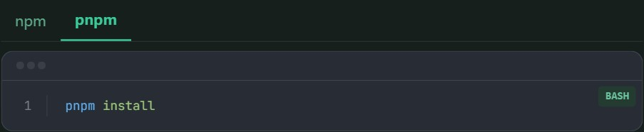
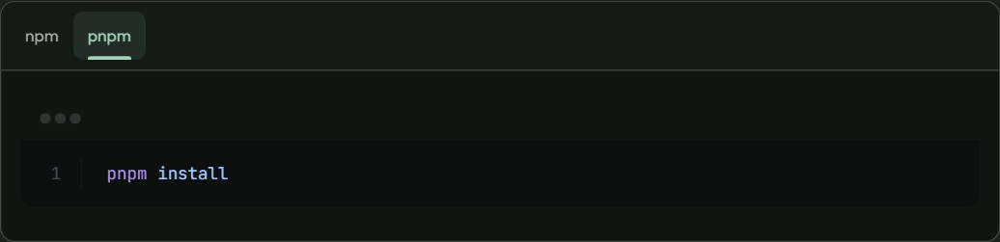
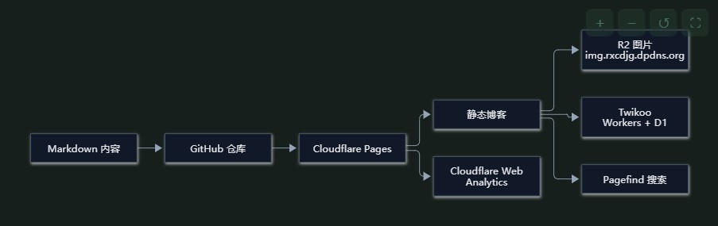
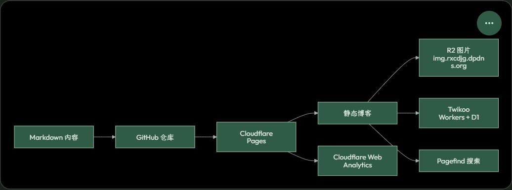

这篇原本用来验收 Firefly 的 Markdown 和 MDX。迁到 Shirone 后，我用同一批 R2 图片和 Mermaid 源码重新试了一遍，也把两套主题写法不一样的地方记在这里。

## 两个主题的语法差异

| 功能 | Firefly 的写法 | Shirone 的写法或表现 |
| --- | --- | --- |
| 表格、任务列表、脚注 | 普通 Markdown | 写法相同 |
| 代码标签页 | `::: code-group` 或 MDX 的 `TabGroup` | `::: tabs` 配合 `@tab`，每一页可放完整 Markdown |
| 步骤条 | MDX 的 `Steps` 和 `StepItem` | `:::steps` 包裹编号列表 |
| 提醒框 | GitHub Alert，可加同行标题和 `-` 折叠 | 基础 Alert 可直接用。自定义标题用容器，折叠用 `:::details` 或 `::: collapse` |
| 图片网格 | `[grid]` 和 `[/grid]` | `:::grid` 可指定列数、比例和裁切 |
| 图注 | 通常显示图片的替代文字 | 用 Markdown 图片的 title 指定可见图注，替代文字单独填写 |
| 图表 | 构建时渲染 Mermaid，另有 PlantUML 围栏 | 浏览器在有图的页面渲染 Mermaid，PlantUML 围栏按普通代码处理 |
| 数学与化学公式 | KaTeX，本站还加载了 `mhchem` | 普通 KaTeX 可用，Firefly 的 `\ce{}` 要换写法 |
| 文章内链 | `[[文章]]` 可生成链接或卡片 | 用标准 Markdown 链接，需要用到卡片时再决定呈现方式 |
| 剧透、GitHub 卡片 | `:spoiler[文字]` 和 `::github{repo="owner/repo"}` | 写法相同 |
| 技术文档 | 普通列表、表格，复杂效果可写 MDX | Markdown 自带文件树、代码树、字段卡片、缩写释义和浮动标注 |

Firefly 的时间线、徽章等 MDX 组件绑定主题。Shirone 也能写 MDX，这篇用普通 Markdown 就可以展示所需内容。友情链接、留言板等页面能力另行验收。

## 基础排版与文章链接

- [x] 普通链接可打开[搭建日志](/posts/site-build-log-2026/)。
- [x] **粗体**、*斜体*、~~删除线~~和 `行内代码` 正常显示。
- [x] [跳到本页的公式](#数学公式)和脚注[^syntax]可用。

[^syntax]: 这条脚注用标准 GitHub 风格 Markdown 写法。

剧透示例。:spoiler[点开之后可以读到 **隐藏内容**。]

## 提醒框与折叠

> [!NOTE]
> 这条基础 GitHub Alert 的写法两边通用。

:::warning[生产环境注意]

上线前先验证正式域名、旧评论和旧文章地址。

:::

:::details[展开验收说明]

打开文章后切换深浅色，再检查图表和标签页是否正常。

:::

## 安装与启动的同步标签页

Firefly 这篇的代码组和 MDX 标签页原本各有一套切换。Shirone 可以通过同一个组名，让上面的安装和下面的启动一起切到 npm 或 pnpm。

::: tabs#package-manager
@tab npm#npm

~~~bash
npm install
~~~

@tab pnpm#pnpm

~~~bash
pnpm install
~~~

:::

::: tabs#package-manager
@tab npm#npm

~~~bash
npm run dev
~~~

@tab pnpm#pnpm

~~~bash
pnpm dev
~~~

:::

~~~ts title="feature-check.ts" showLineNumbers {2} ins={3}
type TestResult = "pass" | "fail";
const status = 200;
const result: TestResult = status === 200 ? "pass" : "fail";
console.log(result);
~~~

## 步骤、文件树与字段

:::steps{title="本地验收"}

1. 安装依赖并构建静态文件。
2. 打开预览，核对封面和远程图片。
3. 切换标签页，再试一次移动端放大图表。

:::

:::file-tree{title="带封面的文章目录"}

- src/
  - content/
    - posts/
      - feature-test-2026/
        - index.md
        - cover.webp

:::

:::code-tree{title="同一站点的两份配置" entry="esa.jsonc"}

~~~json title="esa.jsonc"
{
  "buildCommand": "pnpm build",
  "assets": { "directory": "./dist" }
}
~~~

~~~yaml title="post-frontmatter.yaml"
title: 博客语法测试
published: 2026-10-29
draft: false
~~~

:::

:::: field-group

::: field published
@type date
@required

文章的发布日期，格式为 `YYYY-MM-DD`。
:::

::: field comment
@type boolean
@default `true`
@optional

单篇文章是否允许显示评论，由站点的评论总开关决定是否加载组件。
:::

::::

构建部署时记住 ==先校验静态产物==。SSR 指的是在内容送到浏览器前完成渲染 [+rendering]。

*[SSR]: Server-Side Rendering

[+rendering]: 这里特指页面 HTML 在构建时生成。Mermaid 的最终 SVG 则由浏览器生成。

## R2 图片、图注与网格

:::grid{columns="2" aspect="4/3" fit="cover"}

:::

## 数学公式

行内公式是 $E = mc^2$。

$$
\int_0^1 x^2 \, dx = \frac{1}{3}
$$

原来的化学反应式改用普通 LaTeX，保留系数、下标和箭头。

$$
\mathrm{CH_4} + 2\mathrm{O_2} \rightarrow \mathrm{CO_2} + 2\mathrm{H_2O}
$$

## Mermaid 流程图与时序图

沿用 Firefly 原文的两张图。首次载入 Shirone 时，浏览器需要先加载 Mermaid 才能看到 SVG。

~~~mermaid
flowchart LR
  A[Markdown] --> B[Astro]
  B --> C[Cloudflare Pages]
  C --> D[R2 图片]
  C --> E[Twikoo 评论]
  D --> F[img.rxcdjg.dpdns.org]
~~~

~~~mermaid
sequenceDiagram
  participant User as 读者
  participant Pages as Cloudflare Pages
  participant R2 as R2 图片
  User->>Pages: 打开文章
  Pages-->>User: 返回静态 HTML
  User->>R2: 请求远程图片
  R2-->>User: 返回 WebP
~~~

## 视频指令与 GitHub 卡片

Firefly 原文把视频嵌入写成了示例。Shirone 可用专用指令，并按点击或靠近视口加载。下面仍保留为写法示例。

~~~markdown
::bilibili{bvid="替换为实际 BV 号" title="演示视频"}
::youtube{id="替换为 11 位视频 ID" title="演示视频"}
~~~

::github{repo="WirepullerDX/ayaka-meme-pack"}

## 实际渲染对照

以下截图来自同一个桌面浏览器视口，按 Firefly 正式站、Shirone 本地预览的顺序排列。点击图片可以放大。

### 代码标签页

两边都选中了 pnpm。Firefly 用标签下划线标出当前选项，Shirone 还给选中的标签加了底色。上面的两组 Shirone 示例可以一起切换。

:::grid{columns="2" aspect="4/1" fit="contain"}

:::

### 搭建日志里的架构图

这两张图都来自[博客搭建日志](/posts/site-build-log-2026/)。Firefly 用折线连到节点，Shirone 用带弧度的连接线。截图中两边的字都在框内，Shirone 把较长的 R2 域名再折了一行。

:::grid{columns="2" aspect="3/1" fit="contain"}

:::

[查看 Firefly 版原文（MDX）](https://github.com/WirepullerDX/blog/blob/0ae07f9726a115ffd33622f0eeb4f831d73ef4e5/src/content/posts/feature-test-2026/index.mdx)
